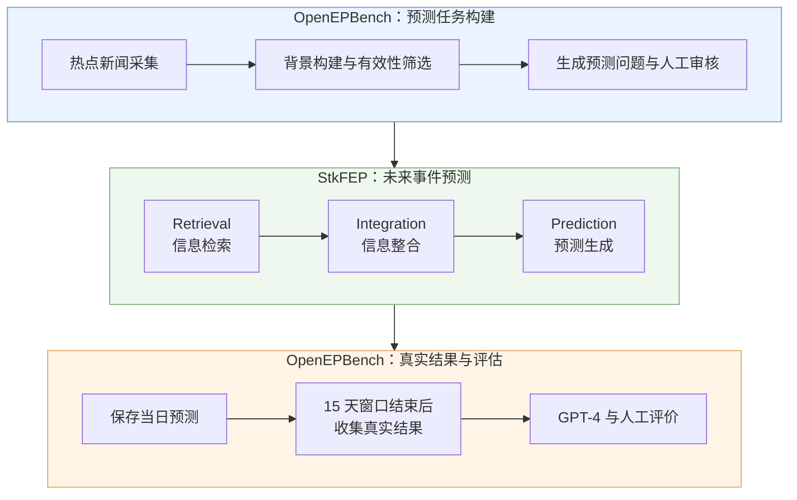
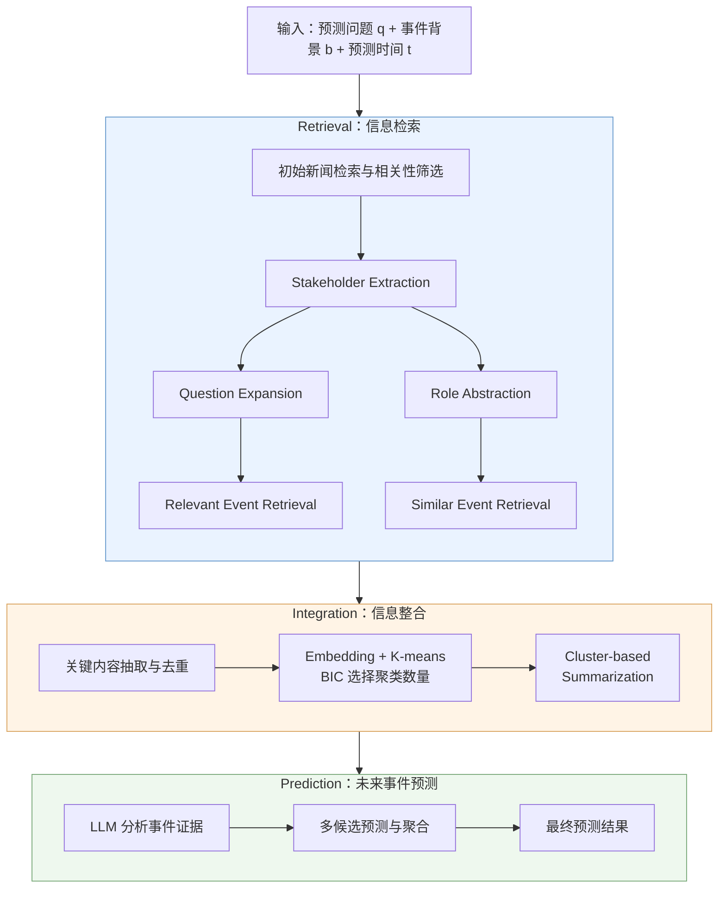
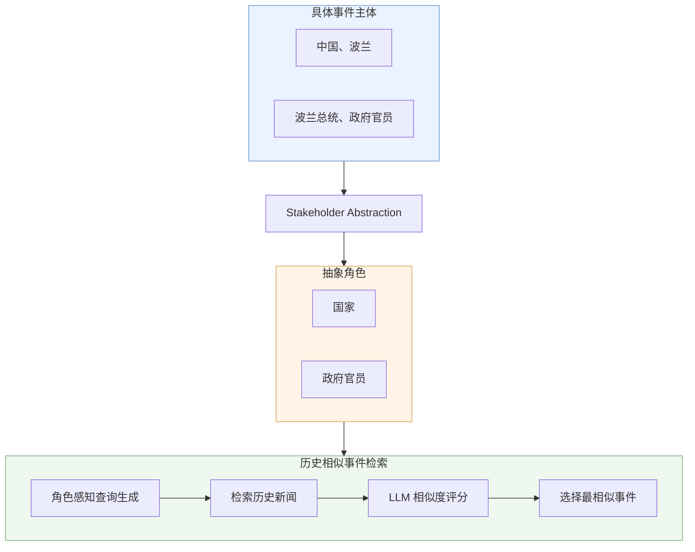
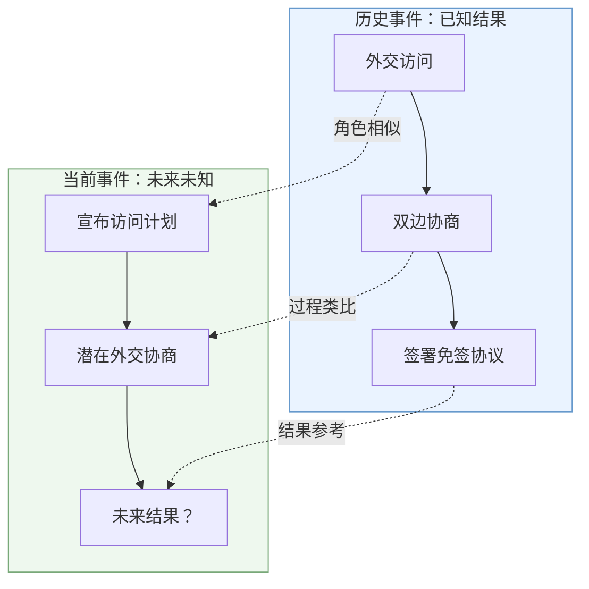
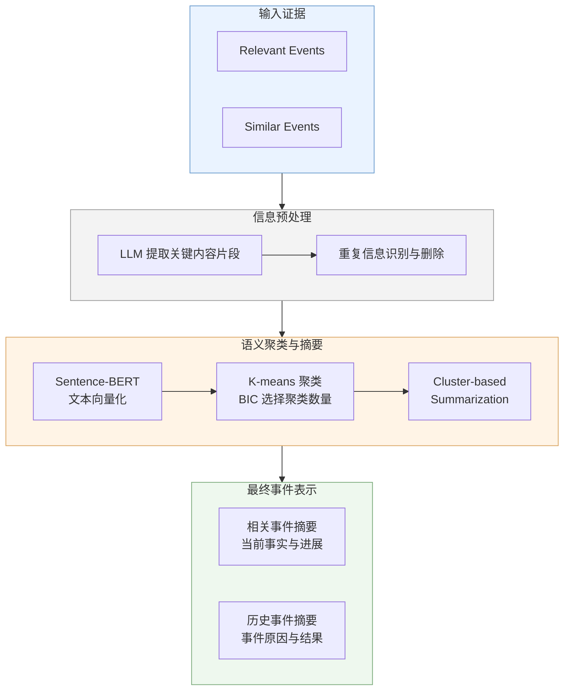
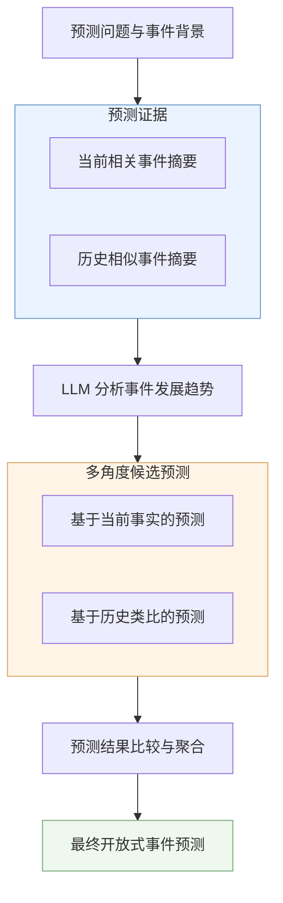
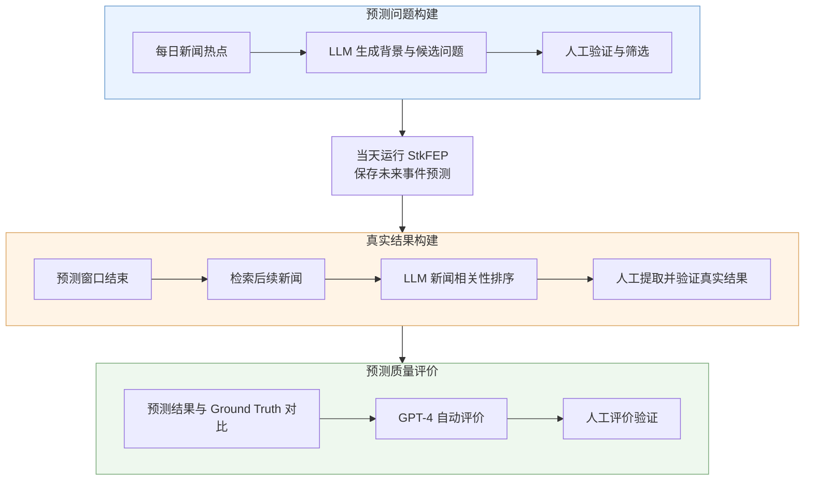
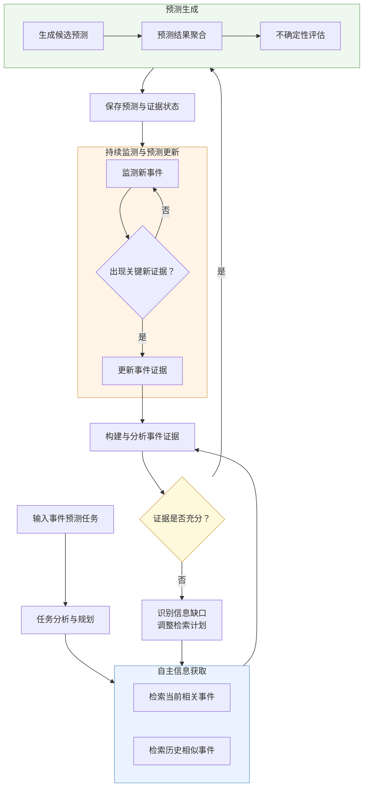
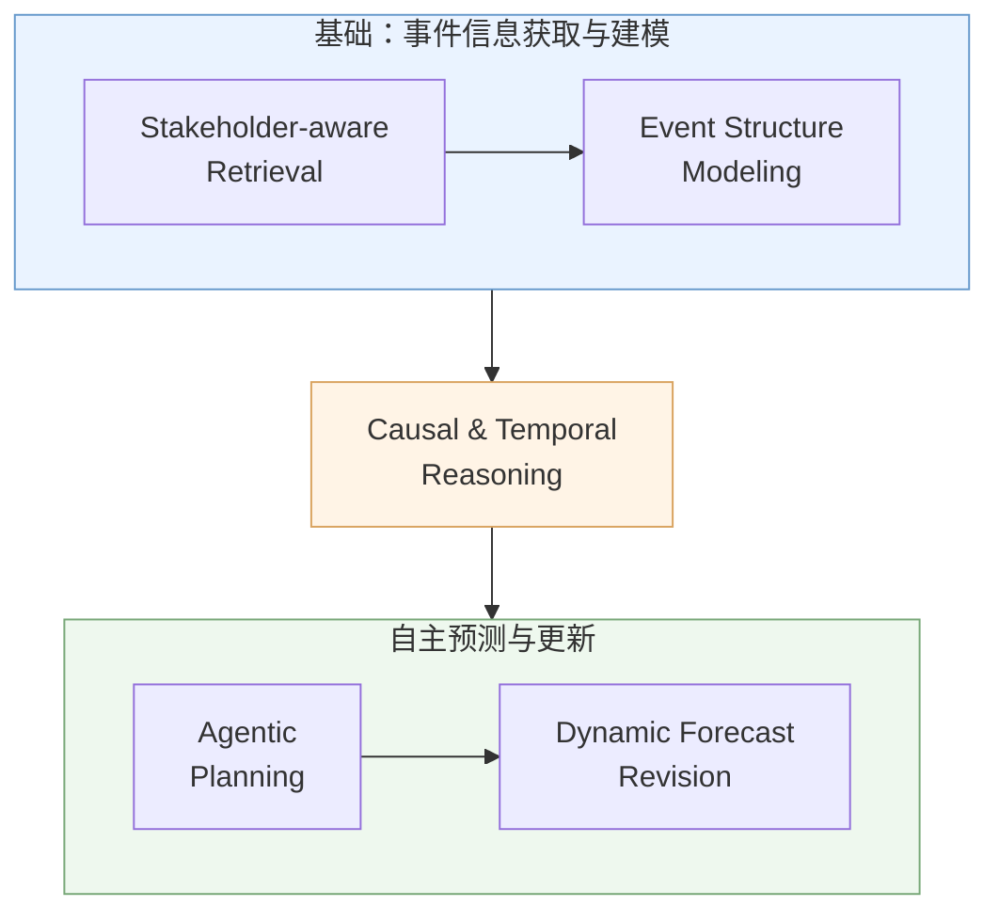

# OpenEP: Open-Ended Future Event Prediction 论文阅读笔记

## 论文基本信息

| 项目     | 内容                                                    |
| ------ | ----------------------------------------------------- |
| 论文标题   | OpenEP: Open-Ended Future Event Prediction            |
| 中文名称   | 开放式未来事件预测                                             |
| 作者     | Yong Guan, Hao Peng, Xiaozhi Wang, Lei Hou, Juanzi Li |
| 发表年份   | 2026                                                  |
| 发表期刊   | ACM Transactions on Information Systems (TOIS)        |
| DOI    | <https://doi.org/10.1145/3802922>                     |
| GitHub | <https://github.com/ncepu-eai/OpenEP>                 |
| 研究领域   | Future Event Prediction、LLM、Information Retrieval、NLP |

### 论文概述

本文研究开放式未来事件预测（Open-Ended Future Event Prediction）问题。传统事件预测方法通常将未来事件预测建模为分类任务，要求模型从预定义的答案空间中选择未来事件的结果。然而，现实世界中的事件具有复杂性、动态性和不确定性，其发展过程往往涉及多个参与主体、不同的发展阶段以及多种潜在影响，因此固定答案空间难以完整描述未来事件可能出现的结果。

针对这一问题，论文首先提出了开放式未来事件预测任务 **OpenEP**，并构建了对应的动态评测数据集 **OpenEPBench**。在此基础上，作者进一步设计了基于利益相关方增强的未来事件预测框架 **StkFEP（Stakeholder-enhanced Future Event Prediction）**。

该框架利用事件参与主体扩展检索问题，同时引入当前相关事件和历史相似事件作为预测证据，经过信息整合后，由大语言模型生成开放式未来事件预测。

论文的核心思想是：**通过事件主体分析、历史事件类比和多源信息整合，为大语言模型提供更加丰富且具有事件演化意义的预测依据，从而改善开放式未来事件预测的效果。**

***

## 研究背景与问题定义

### 未来事件预测任务

未来事件预测（Future Event Prediction，FEP）旨在根据当前已经发生的事件及其历史背景，推断未来可能发生的事件及其结果。这类任务在风险预警、政策分析、金融决策和公共安全等领域具有重要的实际应用价值。

例如，当中国宣布扩大免签政策时，人们可能希望预测中国接下来会与哪个国家签署免签协议。为了完成预测，系统不仅需要了解当前的政策变化，还需要分析近期相关国家的外交活动，以及历史上类似协议的签署过程。

传统的事件预测主要可以分为基于非结构化文本的事件预测和基于结构化知识图谱的事件预测。前者直接利用新闻、文档等自然语言信息进行预测，后者则将事件转换为结构化形式，例如包含主体、关系、客体和时间戳的四元组，再根据历史事件关系预测未来。

从预测输出形式来看，现有方法主要集中在二分类与多分类任务。二分类模型判断一个事件是否发生，多分类模型则从预设候选集合中选择最可能的结果。这些任务便于自动评估，但在真实应用中存在明显限制。

### 现有研究的局限性

**首先，传统方法的预测空间受到限制。** 二分类和多分类任务要求模型从预定义答案中进行选择，但真实世界中的事件发展并不存在固定的候选结果。例如，对于一个正在发生的国际贸易争端，未来可能出现政策调整、谈判、经济制裁、合作协议等多种发展方向，很难事先穷举所有可能结果。

**其次，现有研究对事件发展过程的刻画不够完整。** 部分方法主要关注未来事件是否发生，或者预测事件的发生时间与地点，却忽略了事件发展的具体过程、产生的影响以及不同主体的响应行为。这使得预测结果难以支持深入的事件分析。

**最后，已有基于 LLM 的预测方法对事件自身特征的利用仍然不足。** 许多方法采用检索增强的处理流程，即检索与问题相关的文本，再交给 LLM 进行推断。然而，这些方法往往直接使用原始问题或由 LLM 自由生成的查询进行检索，没有充分利用事件参与主体对事件发展的影响。同时，历史上具有类似演化模式的事件也没有得到充分利用。

### OpenEP 的任务定义

为解决以上问题，论文提出 OpenEP，将未来事件预测定义为开放式生成任务。

在该任务中，模型不再需要从固定的候选答案中选择结果，而是根据预测问题和已知背景信息，自由生成未来可能发生的事件描述。预测内容可以涉及时间、地点、事件发展、事件结果、事件影响以及相关主体的响应等多个维度。

需要强调的是，OpenEP 并不要求模型任意生成未来故事，而是希望模型在已有事实和历史信息的基础上，生成具有合理性、具体性和事实依据的未来预测。

| 对比维度 | 传统事件预测       | OpenEP  |
| ---- | ------------ | ------- |
| 任务形式 | 分类或候选排序      | 开放式生成   |
| 输出空间 | 预定义、有限       | 不预先限定   |
| 输出形式 | 类别、实体、Yes/No | 自然语言描述  |
| 预测范围 | 固定维度         | 多角度事件发展 |
| 语义信息 | 相对有限         | 更完整、具体  |
| 评价方法 | Accuracy 等   | 多维度语义评价 |

相比传统方法，OpenEP 的主要变化体现在预测问题更加多样、预测结果的表达形式更加灵活，以及评价方式从简单的分类准确率扩展到多维度的语义质量评价。

***

## 论文的主要贡献

论文的工作可以划分为任务定义、数据集构建和预测方法设计三个层面。

### OpenEP：开放式事件预测任务

论文将未来事件预测从传统的分类问题扩展为生成问题，使模型能够输出自由形式的自然语言预测，并覆盖事件演化过程中的多个方面。

这一贡献主要属于任务定义层面的创新，使未来事件预测更加接近真实世界的信息分析需求。

### OpenEPBench：动态事件预测数据集

为了支持开放式事件预测研究，作者构建了 OpenEPBench 数据集。该数据集从中文和英文新闻热点中生成预测问题，并在问题创建当天完成模型预测。预测窗口结束后，再从真实新闻中提取实际结果作为 Ground Truth。

这种动态构造与即时预测的方式，有助于降低未来信息泄漏的风险，使模型评估更接近真实预测场景。

### StkFEP：利益相关方增强的预测框架

StkFEP 是论文提出的核心方法。作者认为，事件的发展往往受到其中重要参与主体的影响，因此可以通过识别 Stakeholders 来改善信息检索。

在此基础上，StkFEP 同时检索两类信息：一类是与当前预测问题直接相关的事件，另一类是历史上具有类似演化结构的事件。随后，系统利用聚类摘要整合检索信息，并通过 LLM 生成预测结果。

该框架的核心创新集中在**利益相关方驱动的问题扩展、基于角色抽象的历史相似事件检索，以及面向预测的信息整合机制**。

***

## 系统整体架构

### OpenEP 完整工作流程

从完整的实验系统来看，OpenEP 首先通过 OpenEPBench 构造预测任务，然后利用 StkFEP 生成预测，最后在预测窗口结束后收集实际结果并进行评价。

需要注意的是，数据集构建与预测模型运行是两个不同的过程。OpenEPBench 负责产生预测问题和最终评价，而 StkFEP 负责根据问题以及预测时已知的信息生成未来事件预测。

在实际部署中，如果预测问题已经由用户提供，则可以跳过热点采集与问题生成过程，直接将预测问题和事件背景输入 StkFEP。

### StkFEP 核心方法架构

StkFEP 由 Retrieval、Integration 和 Prediction 三个主要模块构成。其中 Retrieval 负责获取当前相关事件和历史相似事件；Integration 负责处理信息冗余并生成摘要；Prediction 则利用这些证据进行预测。

上述流程图是根据论文 Figure 4 及方法描述整理的逻辑架构图。实际实现中，历史相似事件检索还会结合原始预测问题、背景和角色抽象后的信息生成查询，并通过 LLM 对候选事件进行比较和评分。

需要特别指出的是，Relevant Event Retrieval 和 Similar Event Retrieval 并不是完全独立的两个系统，它们共享预测问题及相关背景信息，但采用不同的检索策略。前者侧重实体和上下文相关性，后者侧重历史事件在角色结构和演化模式上的相似性。

***

## StkFEP 方法详解

### 任务形式化

论文将每条预测数据表示为一个五元组：

$$

x_i=(q,t,w,b,o)

$$

其中，$q$ 表示预测问题，$t$ 表示问题建立的时间，$w$ 表示预测时间窗口，$b$ 表示问题背景，$o$ 表示预测窗口结束后获得的真实事件结果。

需要注意，$o$ 只有在未来事件发生并完成标注后才能获得。在实际预测时，模型只能使用预测时间 $t$ 之前已经存在的信息。

论文进一步定义了两类重要的历史事件信息。Relevant Events（$SE$）表示与当前问题直接相关的新闻事件，通常在实体或事实背景上存在联系；Similar Events（$RE$）表示历史上已经发生、与当前问题具有类似事件结构或演化模式的事件，不要求涉及相同的具体实体。

给定原始问题 $q$ 和背景 $b$，系统首先将问题扩展为查询集合 $q'$，然后检索相关事件 $SE$ 和历史相似事件 $RE$，最后生成预测结果 $o'$。

整个过程可以概括为：

$$  
o'=f(q,b,SE,RE)  
$$

这一公式是对论文流程的简化表达，主要用于理解系统输入与输出之间的关系。

### Retrieval：信息检索

Retrieval 是 StkFEP 的核心模块，其主要目标是获得足够丰富、相关且有助于理解事件发展规律的信息。

作者认为，简单使用原始问题检索新闻往往会遗漏重要证据。例如，预测一个国家是否将签署某项外交协议，仅搜索协议名称可能无法获取与该协议有关的外交访问、政府表态以及其他重要主体的行动。

因此，论文采用基于 Stakeholders 的问题扩展策略，并进一步结合角色抽象检索历史相似事件。

#### 初始新闻检索与 Stakeholder Extraction

系统首先根据原始预测问题进行新闻检索，并通过 LLM 判断新闻内容与问题的相关性，过滤无关报道。然后从筛选后的新闻中提取 Stakeholders，即与事件发展密切相关的重要参与主体。

Stakeholders 可以是国家、政府机构、组织、企业或关键人物等。在某些事件中，其他具有重要语义作用的实体也可能被识别为关键信息。

例如，针对“中国下一步可能与哪个国家签订免签协议”这一问题，相关报道可能涉及中国、澳大利亚、波兰以及相关政府官员。这些实体分别代表不同的事件参与者，并能够帮助模型识别新的检索方向。

这种做法的基本假设是：**事件的发展受到相关主体及其互动行为的影响，因此围绕 Stakeholders 获取信息，比单纯围绕原始问题进行检索更有可能获得完整的预测证据。**

#### Stakeholder-enhanced Question Expansion

获得 Stakeholders 后，系统结合原始问题、事件背景和相关主体，使用 LLM 生成多个扩展检索问题。

例如，原始问题关注中国下一步可能与哪个国家签署免签协议，而扩展问题可以分别关注中国近期的外交访问安排、与不同国家的签证便利化谈判，以及潜在协议相关方的政策动向。

通过这种方式，系统将一个相对集中的预测问题扩展为多个信息需求，从而提高检索结果的覆盖率。

与完全依赖 LLM 自由生成扩展问题的方法相比，StkFEP 的关键区别是将事件参与主体作为显式指导信息，使问题扩展更贴近事件自身的结构与发展特征。

#### Relevant Event Retrieval

系统使用原始问题和扩展问题共同检索新闻，并通过 LLM 对检索结果进行相关性评分和筛选。

相关事件主要提供当前事件的发展背景、重要事实以及可能预示未来变化的信号。例如，某国领导人宣布即将访问中国，就可能成为预测双边外交协议的重要证据。

Relevant Events 的核心价值在于描述**当前事件已经发展到什么阶段，以及有哪些事实可能影响其后续变化**。

可以将相关事件集合表示为：

$$  
SE={e_1,e_2,\ldots,e_n}  
$$

其中每个 $e_i$ 表示一条与预测问题直接相关的新闻事件或信息。

#### Stakeholder Abstraction

历史相似事件检索需要解决一个特殊问题：如果检索查询中包含大量具体实体，搜索结果通常会集中在与当前事件直接相关的新闻上，而不容易发现具有类似发展模式、但参与者完全不同的历史事件。

为解决这一问题，作者提出将具体 Stakeholders 抽象为更加一般的角色。例如，将具体国家抽象为“国家”，将某位总统抽象为“政府官员”。

这样，事件不再只由具体实体描述，还可以从更一般的参与者角色和互动模式进行理解。

需要强调，角色抽象并不意味着仅通过角色是否相同来判断事件相似性。论文将抽象角色用于生成候选事件，最终还需要由 LLM 结合事件描述与上下文判断是否存在有意义的类比关系。

#### Similar Event Retrieval

在生成角色感知的检索查询后，系统从新闻来源中查找历史相似事件。

例如，当前事件是某国领导人即将进行外交访问，而历史事件中可能存在其他国家通过外交访问和谈判最终签署签证协议的案例。虽然两件事涉及的国家和人物不同，但它们可能具有相似的演化结构。

历史相似事件提供的是潜在的演化模式，而不是未来结果的直接证据。因此，即使两个事件具有相似结构，也不能保证它们最终产生相同结果。

在具体实现中，LLM 会对候选历史事件进行比较和评分，综合考虑 Stakeholder Roles、事件描述及上下文关联，最后选择相似度最高的一个历史事件作为预测参考。

这一策略可以视为一种**由利益相关方角色抽象驱动的历史事件类比检索机制**。

从技术本质来看，这种方法与传统基于向量语义相似度的检索存在一定差异。普通语义检索更容易返回文字内容、主题或实体相近的新闻，而 StkFEP 希望通过角色抽象获得在更高层次事件结构上相似的历史案例。

不过，论文并没有提出独立的事件结构相似度学习模型，最终的相似性判断仍主要依赖 LLM 的比较与评分能力。

### Integration：信息整合

Retrieval 阶段通常会产生大量新闻信息，其中包含重复报道、无关细节以及语义重叠的内容。如果直接将这些信息全部输入 LLM，不仅会增加计算成本，还可能由于上下文冗余而降低模型对关键证据的利用效率。

传统信息整合方法通常为每篇新闻分别生成摘要，但由于不同新闻可能报道同一事实，逐篇摘要并不能充分消除跨文档冗余。

因此，论文提出基于聚类的摘要方法，即 Cluster-based Summarization。

#### 关键信息片段抽取与去重

系统首先利用 LLM 从检索到的新闻中抽取关键文本片段。这些片段保留事件的主要事实和重要信息，同时删除重复或高度相似的内容。

这种处理方式将信息整合的对象从完整新闻文章转变为更细粒度的文本片段，有利于处理不同文章之间的事实重叠问题。

#### 文本向量化与聚类

系统使用 Sentence-BERT 等文本嵌入模型对片段进行向量化表示。

对于文本片段 $s_i$，可以将向量化过程表示为：

$$  
v_i=\operatorname{Encoder}(s_i)  
$$

随后，作者使用 K-means 对文本片段进行聚类，并采用贝叶斯信息准则（BIC）辅助确定聚类数量。

聚类的目的是将语义相关的信息组织在一起，从而为后续摘要提供更加合理的信息结构。

#### 类簇级摘要

聚类完成后，系统使用 LLM 分别为每个 Cluster 生成简洁摘要，保留该类簇内最重要的信息。

与普通的逐文档摘要相比，这种方式能够对来自不同新闻、但表达同一类事实的信息进行联合整理。

论文对 Relevant Events 和 Similar Events 都执行这一处理流程，但两者的摘要重点不同。对于当前相关事件，由于最终结果尚未确定，系统主要保留当前发展状态和背景信息；对于历史相似事件，由于其结果已经发生，系统则更关注事件发展的原因和最终结果。

最终，这些聚类摘要构成 Prediction 模块使用的事件证据表示。

图中的处理模块是共享的逻辑示意。实际处理中，相关事件和历史相似事件分别执行抽取、去重、聚类和摘要，而不是必须将两类新闻混合为一个聚类集合。

整体来看，Integration 模块主要解决两个问题：一是通过去重和聚类降低多篇新闻之间的冗余，二是通过类簇级摘要提高模型对重要事件证据的利用效率。

### Prediction：未来事件预测

Prediction 模块是 StkFEP 的最终阶段，其任务是综合当前相关事件与历史相似事件的信息，推断未来可能发生的结果。

系统将原始预测问题、事件背景以及 Integration 阶段生成的摘要作为主要输入，由 LLM 分析事件的发展趋势和可能结果。

由于 LLM 在复杂预测任务中可能出现随机性、过度自信及输出不一致等问题，论文采用基于聚合的预测策略。模型从不同信息视角获得多个候选预测，并综合不同答案形成最终输出。

对于事件结果、事件影响和事件发展等问题，模型输出自由形式的自然语言描述。对于时间类型的问题，论文的实验设置要求模型从多个时间区间中选择最可能的结果。

该图表示论文的多角度预测与结果聚合思想，并不意味着作者训练了两个独立预测器。

这一阶段没有设计新的神经网络预测头，而是利用现有 LLM 对检索证据进行分析、推断和结果聚合。

从方法本质来看，StkFEP 属于一种**面向事件预测的检索增强式 LLM 推理框架**，而不是一个需要重新训练的独立预测基础模型。

***

## OpenEPBench 数据集构建

### 数据来源与规模

OpenEPBench 使用中文和英文新闻数据，以支持跨语言的事件预测实验。中文热点来自知乎，英文热点来自 Google News。对于每个热点，作者进一步检索相关报道并构建背景信息。

最终数据集包含 983 条有效预测问题，其中中文数据 869 条、英文数据 114 条。

| 数据集 | 热点数量 | 预测问题数量 | 数据采集时间                  |
| --- | ---- | ------ | ----------------------- |
| 中文  | 192  | 869    | 2024-06-01 至 2024-07-10 |
| 英文  | 27   | 114    | 2024-07-01 至 2024-07-10 |
| 合计  | 219  | 983    | —                       |

论文采用 15 天预测窗口，主要关注短期未来事件的发展。

### 预测问题生成

作者从七个维度生成预测问题，分别是事件时间、地点、发展过程、结果、影响、相关主体响应，以及其他无法归入前述类别的问题。

| 类型                | 具体预测内容     |
| ----------------- | ---------- |
| Time              | 未来事件发生的时间  |
| Location          | 未来事件发生的地点  |
| Event Development | 事件后续发展与转折  |
| Event Outcome     | 事件最终产生的结果  |
| Event Impact      | 事件对其他领域的影响 |
| Event Response    | 相关主体对事件的响应 |
| Other             | 其他预测问题     |

问题构建过程中，系统首先采集热点并检索背景新闻，随后由 LLM 判断事件是否具有持续性与未来相关性。对于满足条件的热点，LLM 生成多个候选预测问题，再由人工审核其可回答性、具体性和实时相关性。

这一构建方式使数据集不局限于单个事件结果，而是覆盖事件演化的不同阶段与观察角度。

### Ground Truth 构建

在预测问题生成并完成测试后，系统等待相应的预测窗口结束，再检索窗口期间发生的相关新闻。

LLM 首先按照新闻与实际事件结果的相关程度进行排序，评价等级包括 Irrelevant、Neutral、Relevant 和 Highly Relevant。随后人工标注者从高相关性新闻中提取明确包含实际事件结果的文本片段。

每个结果由两名标注者独立审核。如果存在明显质量问题或无法解决的标注分歧，该样本将被排除。

最终，作者从 1,269 个候选结果中保留了 983 个有效样本。

这种数据构造方式的关键在于，**预测时不提供未来结果，而是在实际预测结束后才补充 Ground Truth**，从而使实验更接近真实预测条件。

### 数据集构建与评价闭环

需要说明的是，这里的人工验证与 GPT-4 评价属于 Benchmark 构建与实验评估过程，不是 StkFEP 在实际预测时必须执行的步骤。

***

## 实验设置与结果

### 实验模型与 Baseline

论文使用 GPT-3.5、GLM-4、Llama3-8B 和 Mistral-7B 等大语言模型作为预测骨干，并使用 T5、mT5 作为非 LLM 对比方法。

对于检索和信息整合，论文构建了多个 Baseline。

**DR + Summ** 使用原始预测问题直接检索新闻，并对各篇文档生成摘要。

**DR + SoS** 在直接检索的基础上增加第二轮摘要整合，即 Summarization-over-Summarization。

**GQR + SoS** 使用 LLM 生成多个检索问题，再采用两阶段摘要处理信息。

相比之下，StkFEP 进一步引入了基于 Stakeholders 的问题扩展、历史相似事件检索以及聚类式信息整合。

### 评价方法

对于非时间类的开放式预测问题，论文使用 GPT-4 从 Accuracy、Completeness、Relevance、Specificity 和 Reasonableness 五个维度评价结果。

Accuracy 主要衡量预测是否命中真实结果的核心方面，Completeness 衡量覆盖程度，Relevance 衡量预测与实际结果的相关性，Specificity 关注预测是否具体，Reasonableness 则评估逻辑合理性。

| 指标             | 含义             | 评分方式  |
| -------------- | -------------- | ----- |
| Accuracy       | 是否正确预测至少一个核心结果 | 0 / 1 |
| Completeness   | 预测覆盖实际结果的程度    | 0–1   |
| Relevance      | 预测内容与实际结果的关联程度 | 1–5   |
| Specificity    | 预测是否具体         | 1–5   |
| Reasonableness | 预测是否符合逻辑       | 1–5   |

论文要求评价模型对评分提供置信度分布，并通过归一化期望分数进行聚合，同时利用人工评价验证自动评分的有效性。

对于时间类问题，作者将 15 天预测窗口划分为三个连续的五天区间，再增加“未发生”选项，通过四分类准确率评价预测结果。

### 总体实验结果

以 GPT-3.5 为例，StkFEP 在中文和英文数据上的总体得分均优于所比较的 Baseline。

| 方法        | 中文总体得分    | 英文总体得分    |
| --------- | --------- | --------- |
| DR + Summ | 37.52     | 37.41     |
| DR + SoS  | 41.12     | 39.85     |
| GQR + SoS | 43.78     | 43.58     |
| StkFEP    | **46.95** | **46.03** |

在中文数据上，StkFEP 相较于 GQR + SoS 提升了 3.17 分；在英文数据上提升了 2.45 分。

实验说明，利用利益相关方指导检索并加入历史相似事件，能够在整体上改善开放式未来事件预测的效果。

不过，即使使用 StkFEP，模型的总体分数依然不高，说明开放式未来事件预测仍然具有较大挑战。

这里的总体得分是论文多维评价指标聚合后的分数，不应直接理解为完整预测正确的事件比例。

### 消融实验

论文通过移除不同模块，分析 StkFEP 各组件对最终性能的影响。

| 实验设置              | GPT-3.5   | GLM-4     |
| ----------------- | --------- | --------- |
| 完整 StkFEP         | **46.95** | **46.27** |
| 移除 Cluster-Summ   | 46.11     | 45.38     |
| 移除 Similar Events | 45.65     | 44.79     |
| 移除 Stakeholders   | 44.28     | 42.80     |

从结果可以发现，移除 Stakeholders 后的性能下降最明显，表明事件主体信息对于检索范围扩展和历史事件匹配具有重要意义。

移除 Similar Events 后性能也出现下降，说明历史事件的发展模式能够为未来预测提供额外参考。

此外，去掉 Cluster-based Summarization 后，模型表现有所下降，表明聚类式信息整合可以有效改善检索信息的组织和利用。

总体而言，三个模块均对 StkFEP 的性能提升产生了积极作用，其中 Stakeholder 相关设计的贡献尤为突出。

### 预测质量与错误分析

论文进一步发现，大模型生成的未来事件预测往往具有较好的逻辑合理性，但在相关性和完整性方面存在明显不足。

一方面，模型能够生成听起来合理的未来叙述，但这些内容不一定与预测问题的具体背景密切相关。另一方面，模型即使成功预测了某个重要方面，也经常遗漏其他实际发生的结果。

作者将错误划分为四种类型：

| 错误类型                           | 具体表现        | 错误样本中的占比 |
| ------------------------------ | ----------- | -------- |
| Incomplete Prediction          | 遗漏部分实际事件结果  | 46%      |
| Underspecified Prediction      | 预测描述过于笼统    | 54%      |
| Irrelevant Prediction          | 预测内容偏离问题    | 26%      |
| Common Sense Misinterpretation | 预测违背常识或基本逻辑 | 14%      |

这些比例来自对 50 个错误预测样本的分析，错误类型可能同时存在，因此总和可以超过 100%。

此外，作者通过人工评价与 LLM 自动评价的相关性分析发现，GPT-4 评分与人工评分的 Spearman 相关系数约为 0.45，说明 LLM 评价虽然具有一定参考价值，但仍不能完全替代人工判断。

### 动态预测实验

论文还研究了预测结果如何随时间发生变化。作者选择了 22 个在 10 天后揭晓结果的问题，并使用 GPT-3.5 和 GLM-4 进行每日预测。

实验表明，随着新信息不断出现，模型的预测质量整体呈改善趋势，但在事件发展的早期阶段，预测结果可能出现较大波动。

作者发现，公共讨论热度和新闻信息密度会影响预测稳定性。在事件刚刚发生时，大量新闻和讨论同时涌现，模型容易受到短期信息的影响。随着事件进展和更多可靠证据出现，预测结果逐渐趋于稳定。

这一现象说明，未来事件预测不仅需要检索相关证据，还需要合理处理新旧信息之间的关系。

不过，论文中的每日预测属于重复执行预测的实验，并不意味着 StkFEP 已经具备自主决定何时重新预测、如何获取新证据的 Agent 能力。

***

## 论文创新性分析

### 任务定义层面

OpenEP 最直接的创新是将事件预测从固定答案空间中的分类问题，转变为开放式自然语言生成问题。

这一变化扩大了事件预测的研究范围，使模型能够分析事件发展过程、潜在结果和外部影响，而不是仅输出一个标签或实体。

### 检索方法层面

StkFEP 将 Stakeholders 显式引入检索问题扩展过程，使检索不再只围绕预测问题本身展开，而是进一步考虑事件中的重要参与主体及其行为。

这种设计能够从不同主体视角搜集信息，为预测提供更加丰富的背景证据。

### 历史类比层面

论文通过 Stakeholder Abstraction，将具体实体转化为一般角色，再检索具有类似角色结构和演化模式的历史事件。

这使模型不再局限于同一实体或同一主题的新闻，而是能够寻找跨实体的历史先例。

不过，这种类比仍主要依赖 LLM 的语义理解和相似度判断，并没有建立严格的因果迁移模型。

### 信息整合层面

论文采用 K-means 聚类与 Cluster-based Summarization，对多篇新闻中的关键内容进行联合组织和压缩。

这种方法有助于减少冗余信息，改善长上下文中的证据利用效果。

### 创新性质总结

整体来看，论文的主要创新集中在任务定义、Benchmark 构建以及面向事件演化特征的检索增强框架。

StkFEP 并没有提出新的 Transformer 结构，也没有设计独立训练的事件预测基础模型。它更接近一种结合 LLM、信息检索和文本组织技术的系统性方法创新。

***

## 方法局限性

### 事件相似性建模仍然粗糙

论文通过角色抽象和 LLM 相似度评分寻找历史相似事件，但是事件相似性本身是一个复杂的问题。

两件事可能具有相同的参与主体角色或相似的文本描述，却具有不同的社会背景、利益关系和因果机制。因此，历史事件的结果不一定能够直接迁移到当前事件。

论文也明确指出，多粒度事件相似性的统一建模仍然是一个开放问题。

### 缺乏显式因果关系建模

虽然 StkFEP 利用了历史事件演化模式，但没有显式建立事件之间的因果关系。

因此，模型可能只是通过历史类比生成合理的预测，而不一定真正理解事件发生的驱动机制。

如果希望进一步提升预测能力，需要探索如何结合事件之间的时间关系、因果关系及不同主体的决策行为进行建模。

### 缺乏自主迭代推理机制

StkFEP 采用相对固定的 Retrieval → Integration → Prediction 流水线，并不是完整的自主 Agent。

虽然该系统会利用 LLM 执行多步信息处理任务，但论文没有明确设计让模型自主判断证据是否充分、动态制定新检索计划或持续修正推理路径的机制。

论文开展了多日预测实验，观察模型表现如何随新信息出现而变化，但这并不等价于构建了具备长期记忆和自主规划能力的预测 Agent。

### 预测不确定性处理仍然不足

开放式事件预测天然具有较强的不确定性，同一个事件可能沿不同路径发展。

StkFEP 通过候选预测聚合降低部分随机性，但并没有充分建立多分支未来事件的概率模型，也没有系统解决不同预测结果之间的置信度校准问题。

### 计算成本与扩展性问题

论文报告，完整 StkFEP 流水线平均每个预测实例消耗约 24.8K tokens。

作者在初步实验中尝试使用小模型承担部分中间信息处理任务，使平均消耗降低到 7.8K tokens 以下，同时没有观察到明显性能下降。

不过，对于大规模新闻流或需要频繁更新预测的实际应用，检索、文本处理和多轮 LLM 调用的成本仍然需要进一步优化。

### 长期事件预测能力尚未验证

OpenEPBench 主要研究未来 15 天的短期事件预测。

对于地缘政治、经济政策或公共事务等可能持续数月甚至数年的事件，现有实验还不足以验证方法在长时间跨度上的预测能力。

### Benchmark 的评测偏差

OpenEPBench 只将有可验证结果的问题纳入主要数据集，这有利于构建 Ground Truth，但也意味着最终评测数据与真实世界中的全部预测问题存在一定差异。

真实场景中，许多事件在预测窗口内可能没有发生，也可能出现无法确认结果的情况。因此，实际预测系统不仅需要预测事件如何发展，还需要判断事件是否会发生，以及预测问题能否在规定时间内得到明确答案。

此外，论文主要采用 LLM 语义评价开放式预测，而不同评判模型对预测完整性、具体性的判断可能存在差异。这也是开放式预测研究需要进一步解决的评价问题。

***

## 科研思考与后续研究方向

本节是基于论文方法和局限性提出的进一步研究思考，并非原论文已经实现的内容。

### 结合事件知识图谱进行结构化推理

StkFEP 主要依靠检索到的文本片段和摘要进行预测，没有显式构建事件知识图谱。

一种可能的改进方向是首先从新闻中抽取结构化事件，包括事件类型、发生时间、参与实体、事件关系及因果依赖，然后将这些信息组织成事件知识图谱。

在预测阶段，模型不仅能够检索语义相关的文本，还可以沿事件关系进行结构化推理，从而更准确地理解事件之间的演化依赖。

这种方式有望将预测依据从文本层面的相似性扩展到事件关系层面的相似性。

### 构建自主事件预测 Agent

StkFEP 当前采用固定流水线，但真实事件预测往往需要多轮信息获取与分析。

例如，当模型发现某个关键参与方的立场尚不明确时，理想的系统应当主动检索该主体的近期表态，而不是直接使用已有信息完成预测。

因此，可以研究一种具备规划能力的事件预测 Agent，使其能够根据证据充分性、预测不确定性和信息缺口动态决定下一步行动。

与 StkFEP 相比，这种 Agentic Future Event Prediction 架构的关键变化在于，系统不再严格按照一次性的固定流水线执行，而是根据当前信息状态自主规划检索、分析和预测行为。

研究的核心问题也随之转变：不再仅仅关注如何在给定证据下预测事件，而是进一步研究**预测系统应该主动获取什么证据、何时停止检索、何时重新预测，以及如何避免无效的推理和工具调用**。

### 基于事件演化链的因果推理

历史相似事件检索的核心问题是：为什么某个历史事件能够为当前事件提供参考？

仅仅因为两个事件包含类似的实体角色或发展步骤，并不能说明它们具有相同的因果机制。

因此，可以尝试在历史事件中识别更完整的演化链，包括关键前置条件、主体行为、环境因素和最终结果，再判断这些因果条件是否在当前事件中成立。

例如，两个国家领导人进行外交访问后都可能签署合作协议，但协议是否能够达成，还可能受到双边关系、政治环境、经济利益及谈判条件等因素影响。如果模型仅依据“外交访问之后曾经签署协议”进行类比，就可能忽略真正决定结果的关键因素。

这种研究可能帮助模型区分真正具有预测价值的历史案例和仅存在表面相似性的历史新闻。

### 面向开放式预测的不确定性建模

未来事件往往存在多个可能的发展方向，而现有系统主要给出一个综合后的预测结果。

一种可能的研究方向是将开放式事件预测拆解成多个具有明确语义的原子事件，并分别估计其发生可能性。

例如，对外交谈判事件，可以分别预测是否举行正式会谈、是否发布联合声明、是否签署协议以及协议是否立即生效。

这样既能保留开放式预测的表达能力，也能够使预测结果更加细粒度和可验证，同时为后续的概率校准研究提供基础。

### 事件预测与 Agent 自主规划结合

从 Agent 研究角度看，StkFEP 的 Retrieval 模块可以进一步发展为一个基于状态的自主信息获取过程。

传统 StkFEP 按照预定义步骤完成 Stakeholder Extraction、Question Expansion 和 Similar Event Retrieval，而 Agent 可以根据预测任务的实际困难动态选择行动。

例如，对于证据较充分的短期事件，Agent 可能只需要检索最新新闻并更新预测；对于具有复杂历史背景的事件，Agent 则可以主动调用历史事件检索、事件关系分析和因果推理工具。

因此，可以进一步将事件预测建模为一个序贯决策问题。系统在每一步根据当前证据状态，决定是继续检索、进行推理、请求其他信息，还是直接输出预测。

这种研究方向不仅关注最终预测性能，还可以同时研究工具调用效率、信息获取成本、推理路径质量以及预测结果的可靠性。

***

## 总结

OpenEP 研究了开放式未来事件预测这一更接近真实世界的任务形式。论文通过 OpenEPBench 构建动态预测数据集，并通过 StkFEP 将 Stakeholder-aware Retrieval、Historical Similar Event Retrieval、Cluster-based Summarization 与 LLM 预测聚合结合起来，形成了一套完整的未来事件预测方法。

其最重要的技术思想是：**事件预测不应仅依赖当前问题的表面语义，而应结合事件参与主体、当前事实和历史类似事件的演化过程，共同推断未来可能出现的结果。**

实验表明，利益相关方增强检索、历史相似事件检索和聚类摘要均能够改善预测表现，其中 Stakeholder 相关设计的贡献最为明显。然而，开放式预测仍然面临预测不完整、信息不相关、事件相似性建模不足及缺乏显式因果推理等问题。

从进一步研究的角度来看，StkFEP 为事件预测提供了一个可扩展的基础框架。后续可以重点探索事件结构化建模、因果与时间推理、自主信息获取、动态预测修正以及预测不确定性校准等方向。

特别是结合 LLM Agent 的规划与自主执行能力，有可能将现有的固定预测流水线扩展为能够持续观察外部事件、主动寻找证据、维护事件状态并不断修正预测的智能系统。

可以将后续研究路线概括为：

这条路线的核心目标，是推动未来事件预测从基于新闻检索和历史类比的语言生成，进一步发展为具有结构化事件理解、动态决策和持续预测能力的智能推理系统。

***

## 重点阅读索引

| 章节               | 页码     | 核心内容                  |
| ---------------- | ------ | --------------------- |
| Introduction     | P2–3   | 研究问题与任务动机             |
| Related Work     | P3–6   | 传统事件预测与已有方法           |
| OpenEPBench      | P6–10  | 动态数据集与标注流程            |
| Task Description | P11    | 任务定义与形式化              |
| Retrieval        | P12–13 | Stakeholder 增强与历史相似事件 |
| Integration      | P13    | 聚类摘要和信息整合             |
| Prediction       | P13–14 | LLM 预测及聚合             |
| Experiments      | P14–23 | 实验设置与结果               |
| Ablation Study   | P21    | 各组件的有效性               |
| Error Analysis   | P23–24 | 预测错误分类                |
| Limitations      | P24–25 | 论文局限与研究方向             |

重点关注论文中的 **Figure 4（StkFEP 整体框架）、Table 2–3（性能比较）和 Table 4（消融实验）**。这几部分最能帮助理解论文的方法设计及其有效性。
