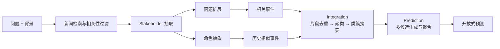

# OpenEP: Open-Ended Future Event Prediction

## 论文信息

| 项目   | 内容                                                    |
| ---- | ----------------------------------------------------- |
| 作者   | Yong Guan, Hao Peng, Xiaozhi Wang, Lei Hou, Juanzi Li |
| 发表   | ACM Transactions on Information Systems (TOIS), 2026  |
| DOI  | <https://doi.org/10.1145/3802922>                     |
| 代码   | <https://github.com/ncepu-eai/OpenEP>                 |

论文提出开放式未来事件预测任务 **OpenEP**、动态评测数据集 **OpenEPBench**，以及检索增强的预测框架 **StkFEP**（Stakeholder-enhanced Future Event Prediction）。

## 研究背景

传统事件预测通常被建模为二分类或多分类任务，即判断事件是否发生，或从预设候选集中选择结果。这类设定便于自动评估，但与真实世界存在明显差距：

- **预测空间受限。** 真实事件的发展方向难以事先穷举，固定候选集无法覆盖政策调整、谈判、制裁等多种可能。
- **过程刻画不完整。** 很多方法只关心事件是否发生、何时何地发生，忽略了事件的发展过程、影响以及其他主体的响应。
- **事件特征利用不足。** 现有 LLM 方法大多直接用原始问题检索新闻，很少利用事件参与主体，也没有充分借鉴历史上具有类似演化模式的事件。

## 任务定义

OpenEP 将未来事件预测定义为开放式生成任务：模型根据预测问题和已知背景，自由生成未来可能发生的事件描述，内容可以覆盖时间、地点、发展过程、结果、影响及各方响应。

预测并非任意生成故事，而是要求在已有事实和历史信息的基础上，给出合理、具体、有事实依据的推断。与分类式预测相比，OpenEP 的输出空间不预先限定，评价方式也从 Accuracy 扩展到多维度的语义评价。

论文将每条数据表示为五元组 $x_i=(q,t,w,b,o)$，其中 $q$ 是预测问题，$t$ 是问题建立时间，$w$ 是预测窗口，$b$ 是背景，$o$ 是窗口结束后的真实结果。实际预测时只能使用 $t$ 之前的信息，$o$ 在预测完成后才补充。

给定问题 $q$ 和背景 $b$，系统检索两类证据并生成预测 $o'$：

$$
o'=f(q,b,SE,RE)
$$

其中 $SE$ 为与当前问题直接相关的新闻事件，$RE$ 为历史上具有类似事件结构或演化模式的相似事件。

## 主要贡献

1. **任务定义**：把事件预测从分类问题扩展为开放式生成问题，覆盖事件演化的多个维度。
2. **OpenEPBench**：从中英文新闻热点动态构建预测问题，在创建当天完成预测，窗口结束后再收集真实结果，以降低未来信息泄漏。
3. **StkFEP**：以利益相关方驱动问题扩展，结合当前相关事件与历史相似事件，经聚类摘要后由 LLM 生成并聚合预测。

## StkFEP 方法

StkFEP 由 Retrieval、Integration、Prediction 三个阶段组成，整体流程如下图（依据论文 Figure 4 整理）。

### Retrieval：信息检索

核心假设是：事件发展受到重要参与主体及其互动的影响，因此围绕 Stakeholders 检索，比只围绕原始问题检索更容易获得完整证据。

1. **初始检索与 Stakeholder 抽取**：先按原始问题检索新闻，用 LLM 过滤无关报道，再从中提取国家、机构、企业、关键人物等参与主体。
2. **问题扩展**：结合原问题、背景和主体，让 LLM 生成多个检索问题，把单一预测问题拆解为多个信息需求。
3. **相关事件检索**：用原始问题加扩展问题检索新闻，并由 LLM 做相关性评分和筛选，用于刻画当前事件的发展阶段与可能影响后续变化的事实。
4. **Stakeholder Abstraction**：把具体实体抽象为一般角色（如“某国”→“国家”，“某总统”→“政府官员”），避免历史检索被具体实体名锁死。
5. **历史相似事件检索**：用角色感知查询检索历史新闻，再由 LLM 综合角色、事件描述和上下文评分，选出最相似的历史事件作为演化参考。

角色抽象只负责生成候选，最终相似性仍由 LLM 判断。论文没有训练独立的事件结构相似度模型。

### Integration：信息整合

检索结果中存在大量重复报道和语义重叠内容，逐篇摘要难以消除跨文档冗余，因此采用聚类式摘要：

- 用 LLM 从新闻中抽取关键文本片段，并删除重复或高度相似的内容；
- 用 Sentence-BERT 等模型将片段向量化，再用 K-means 聚类，以 BIC 辅助确定簇数；
- 为每个类簇生成摘要。相关事件侧重当前事实与进展，历史事件侧重发展原因与最终结果。

这一步同时降低了上下文冗余和后续 LLM 的输入成本。

### Prediction：预测生成

系统将原问题、背景和两类事件摘要交给 LLM，分析事件趋势并生成预测。为缓解 LLM 的随机性和输出不一致，模型从不同信息视角生成多个候选预测，再比较聚合为最终结果。

对于时间类问题，实验将其转化为分类：把 15 天窗口划分为三个五天区间，外加“未发生”选项，以四分类准确率评价。该方法本质上是检索增强的 LLM 推理框架，没有新增预测头，也没有重新训练基础模型。

## OpenEPBench

数据来自中文知乎和英文 Google News 热点，中英文分别采集，最终得到 983 条有效预测问题。

| 数据集 | 热点数 | 预测问题数 | 采集时间                    |
| --- | --- | ----- | ----------------------- |
| 中文  | 192 | 869   | 2024-06-01 至 2024-07-10 |
| 英文  | 27  | 114   | 2024-07-01 至 2024-07-10 |
| 合计  | 219 | 983   | —                       |

预测窗口为 15 天，问题覆盖七个维度：时间、地点、发展过程、结果、影响、相关主体响应和其他。

构建流程为：采集热点并检索背景新闻 → LLM 判断事件是否具有持续性与未来相关性 → LLM 生成候选问题 → 人工审核可回答性、具体性和实时相关性。预测窗口结束后，先由 LLM 按相关程度对后续新闻排序（Irrelevant / Neutral / Relevant / Highly Relevant），再由人工从高相关新闻中提取明确结果，两名标注者独立审核。最终从 1,269 个候选中保留 983 个有效样本。

这一设计的关键是**预测时不提供未来结果，预测结束后才补充 Ground Truth**，使评测更接近真实预测条件。

## 实验

预测骨干使用 GPT-3.5、GLM-4、Llama3-8B、Mistral-7B，另以 T5、mT5 作为非 LLM 对比。检索与整合部分的 baseline 包括：

- **DR + Summ**：用原始问题直接检索，并对各文档摘要；
- **DR + SoS**：在直接检索上增加第二轮摘要整合；
- **GQR + SoS**：由 LLM 生成多个检索问题，再做两阶段摘要。

非时间类预测由 GPT-4 从五个维度评价：

| 指标             | 含义             | 取值    |
| -------------- | -------------- | ----- |
| Accuracy       | 是否命中至少一个核心结果   | 0 / 1 |
| Completeness   | 对实际结果的覆盖程度     | 0–1   |
| Relevance      | 与实际问题及结果的关联程度  | 1–5   |
| Specificity    | 预测是否具体         | 1–5   |
| Reasonableness | 是否符合逻辑         | 1–5   |

评分时要求评价模型给出置信度分布，归一化后聚合，并用人工评价验证自动评分。

### 主要结果

以 GPT-3.5 为骨干，StkFEP 在中英文数据上均优于全部 baseline：

| 方法        | 中文    | 英文    |
| --------- | ----- | ----- |
| DR + Summ | 37.52 | 37.41 |
| DR + SoS  | 41.12 | 39.85 |
| GQR + SoS | 43.78 | 43.58 |
| StkFEP    | **46.95** | **46.03** |

相较 GQR + SoS，中文提升 3.17 分，英文提升 2.45 分。不过整体分数依然不高，说明开放式预测仍有较大挑战；该分数是多指标聚合结果，不等于预测完全正确的比例。

### 消融实验

| 设置                | GPT-3.5   | GLM-4     |
| ----------------- | --------- | --------- |
| 完整 StkFEP         | **46.95** | **46.27** |
| 移除 Cluster-Summ   | 46.11     | 45.38     |
| 移除 Similar Events | 45.65     | 44.79     |
| 移除 Stakeholders   | 44.28     | 42.80     |

三个模块均有正贡献，其中移除 Stakeholders 后下降最明显，说明事件主体信息对扩展检索范围和匹配历史事件最为关键。

### 错误分析

对 50 个错误预测样本的分析显示，模型生成的预测通常逻辑合理，但相关性和完整性不足。错误类型可以并存，因此占比如下（合计超过 100%）：

- **Underspecified Prediction（54%）**：描述过于笼统；
- **Incomplete Prediction（46%）**：遗漏部分实际结果；
- **Irrelevant Prediction（26%）**：偏离预测问题；
- **Common Sense Misinterpretation（14%）**：违背常识或基本逻辑。

此外，GPT-4 自动评分与人工评分的 Spearman 相关系数约为 0.45，说明 LLM 评价有参考价值，但还不能完全替代人工判断。

### 动态预测

论文选取 22 个在 10 天后揭晓结果的问题，用 GPT-3.5 和 GLM-4 每日重复预测。随着新信息出现，预测质量整体改善，但早期波动较大；公共讨论热度和新闻密度会影响预测稳定性。这属于重复执行预测的实验，并不代表 StkFEP 已具备自主决定何时重预测的 Agent 能力。

## 方法局限

- **事件相似性建模粗糙。** 角色抽象加 LLM 评分仍是浅层相似性判断，两个事件可能角色结构相似，却具有不同的社会背景和因果机制，历史结果未必能迁移。
- **缺乏显式因果建模。** 模型利用的是演化模式的相关性，而非事件之间的因果驱动机制。
- **固定流水线，非自主 Agent。** Retrieval → Integration → Prediction 顺序固定，系统不会自主判断证据是否充分、动态调整检索计划或修正推理路径。
- **不确定性处理不足。** 多候选聚合只能降低部分随机性，没有建立多分支未来的概率模型，也未系统解决置信度校准。
- **计算成本较高。** 完整流水线平均每个实例约消耗 24.8K tokens；作者尝试用小模型承担部分中间处理，可降到 7.8K 以下且未见明显性能下降。
- **长期预测尚未验证。** 数据集只覆盖 15 天窗口，不足以验证月级或年级事件的预测能力。
- **Benchmark 存在评测偏差。** 只保留有可验证结果的问题，与真实场景存在差异；LLM 语义评价本身也受评判模型影响。

## 总结

OpenEP 把未来事件预测从封闭分类推向开放式生成，并用动态构建的 OpenEPBench 支持更接近真实条件的评测。StkFEP 的核心思想是：**预测不应只依赖问题的表面语义，而应结合事件参与主体、当前事实和历史类似事件的演化过程共同推断未来。**

实验证明利益相关方增强检索、历史相似事件检索和聚类摘要都能改善表现，其中 Stakeholder 设计的贡献最大。该方法本质上是 LLM、信息检索与文本组织技术的系统性组合，而非新的模型结构。

后续值得关注的方向包括：事件结构化建模、显式因果与时间推理、具备自主规划和动态修正能力的预测 Agent，以及开放式预测的不确定性校准。

重点可看论文 **Figure 4（StkFEP 框架）、Table 2–3（性能比较）和 Table 4（消融实验）**。
